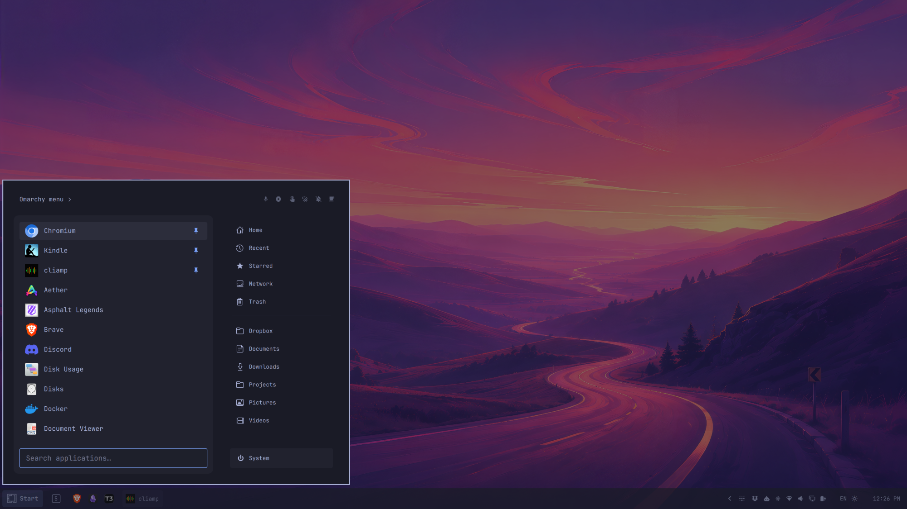

# Tilelane

A bottom taskbar and Start menu for Omarchy.



- See each monitor's windows, grouped by workspace. Within each group,
  windows stay in opening order.
- Click the active task to minimize it. Click it again to restore it.
  Windows keep their tiled or floating mode.
- Pin apps to the taskbar or Start. Find folders through your Files bookmarks.
- Keep your Omarchy theme, widgets, and keyboard shortcuts.

## Requirements

Tested on Omarchy 4.0.6 and 4.5.0 RC1. Tilelane runs inside Omarchy's shell.
It uses the native dock and tip translations when available. They are not
required on 4.0.6. Places uses Files to open folders.
See the [runtime dependencies](docs/architecture.md#processes-and-commands).

## Install

```sh
omarchy plugin add https://github.com/lexeko/tilelane.git
omarchy bar use io.github.lexeko.tilelane
```

For an installation without Git, see [manual installation](docs/recovery.md#manual-installation).

## Use

- Start pins and taskbar pins are independent. Right-click a taskbar pin to
  reorder it.
- The taskbar is semi-transparent by default. Double-click empty taskbar space
  to switch to an opaque background or back. Tilelane saves your choice.
- Hold Ctrl while clicking an app launcher or a place to open a floating window.
- In Start, Ctrl+Enter also launches the selected app as a floating window.
- Window context menus show the configured Omarchy shortcuts for their actions.

Places follows your bookmarks in Files. Names, order, and bookmark changes
update automatically.

On Omarchy 4.5 RC, Tilelane also restores windows minimized through Omarchy's
titlebar or dock. If the dock overlaps the taskbar, a Dock tip lets you move it
to another edge and turn on auto-hide.

## Configure

Manage status widgets through Omarchy. Start, the workspace switcher, and the
task area have fixed positions. The clock stays at the right when enabled.
See [widget configuration](docs/configuration.md) for layout and settings commands.

Pins and preferences are saved in `~/.config/omarchy/shell.json`.
See [settings and reduced motion](docs/recovery.md#recover-pins-or-settings).

## Update

For the GitHub installation above:

```sh
omarchy plugin update io.github.lexeko.tilelane
omarchy restart shell
```

Updates follow the repository's default branch. For a manual installation,
replace the plugin files with a new complete copy.

## Disable or remove

Return to Omarchy's built-in bar:

```sh
omarchy bar reset
```

Then, to remove Tilelane:

```sh
omarchy plugin remove io.github.lexeko.tilelane
```

Pins and preferences remain available for a later install.
See [recovery and cleanup](docs/recovery.md) for settings or minimized windows.

## Documentation

- [Changelog](CHANGELOG.md)
- [Widget and appearance settings](docs/configuration.md)
- [Recovery and troubleshooting](docs/recovery.md)
- [Architecture and dependencies](docs/architecture.md)
- [Contributing](CONTRIBUTING.md)

## License

[MIT](LICENSE). Copyright (c) 2026 Alexey Konoplev.
